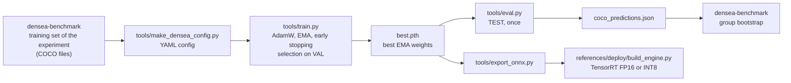

# DenSea RT-DETRv2

Training and evaluation code for **RT-DETRv2** on **DenSea-Aggregated**, the benchmark used in the article
*When Does Synthetic Data Help Underwater Debris Detection? Gap Metrics, Data Regimes and Detector Paradigms*.
It is a derivative of the RT-DETRv2 implementation in [lyuwenyu/RT-DETR](https://github.com/lyuwenyu/RT-DETR)
(Apache-2.0), and sits next to the other two detectors of the study,
[`densea-rfdetr`](https://github.com/asferrer/densea-rfdetr) and
[`densea-diffusiondet`](https://github.com/asferrer/densea-diffusiondet). The group-aware partition, the synthetic
batches, the experiment definitions and the bootstrap evaluation are in
[`densea-benchmark`](https://github.com/asferrer/densea-benchmark); this repository is the detector it calls.

## What changes with respect to upstream

Based on upstream commit [`70eed1e`](https://github.com/lyuwenyu/RT-DETR/commit/70eed1e46c5d705134069a3d55090e58d529f42d)
(2025-01-17), directory `rtdetrv2_pytorch/`. The first commit of this repository is that snapshot, so
`git diff HEAD~1` shows exactly what was changed. The details are in [`CHANGES.md`](CHANGES.md); in short:

- **Data.** `MultiDirCocoDetection` reads COCO files whose images live in several directories; new augmentations
  (rotation, Gaussian blur, noise) in `src/data/transforms`.
- **Model selection.** `best.pth` is the checkpoint with the best validation AP of the EMA weights; early stopping
  (`early_stopping_patience`, `early_stopping_min_delta`); optional per-class metrics.
- **Resume.** The best value and the patience are rebuilt from `log.txt` when training is resumed, and checkpoints are
  written atomically (`save_checkpoint_fast`), so an interrupted run can be continued without changing the result.
- **Faster evaluation.** `FAST_COCOEVAL=1` computes the COCO metrics with
  [faster-coco-eval](https://github.com/MiXaiLL76/faster_coco_eval); the results match pycocotools to 1e-15.
- **Fixes.** Autocast in the forward pass of the training step, softmax over classes in the post-processor,
  `torch.amp.GradScaler`, relative `__include__` resolution in YAML files.
- **Configuration.** `configs/densea/rtdetrv2_r50vd_densea.template.yml` (the configuration of the study) and
  `tools/make_densea_config.py`, which fills it in with your paths.
- **Evaluation and deployment tools.** `tools/eval.py` (PyTorch, ONNX and TensorRT; COCO metrics, confusion matrix,
  per-class analysis), `tools/export_onnx.py`, `tools/replace_erf_onnx.py`, `tools/create_calibration_set.py`,
  `references/deploy/build_engine.py` and the ONNX Runtime and TensorRT inference scripts, latency and complexity
  tools, tests.

## Workflow

The experiments are defined and evaluated in `densea-benchmark`; this repository trains one detector and writes its detections:



## Installation

With Docker (NVIDIA Container Toolkit and a GPU with 24 GB or more; the study used an RTX 5090 with batch size 32):

```bash
DATA_ROOT=/path/to/densea_aggregated RUNS_DIR=/path/to/runs docker compose up -d --build
docker exec -it densea_rtdetrv2 bash        # working directory: /app/RT-DETR
```

Without Docker (Python 3.11, PyTorch 2.7.0 and torchvision 0.22.0 with CUDA 12.8):

```bash
pip install -r rtdetrv2_pytorch/requirements.txt
```

`requirements.txt` lists the versions used for the reported results. The ImageNet weights of the PResNet-50vd backbone
are downloaded by the code on first use.

## Data

Download **DenSea-Aggregated** (*DenSea-Aggregated: A Group-Aware Benchmark for Underwater Debris Detection*) from the [dataset page of the University of Alicante group](https://www.dlsi.ua.es/~jgallego/datasets/) and unpack it. It contains
`annotations/{train,val,test}.json` (COCO, 8 classes, with a `group` per image) and the `images/` folder, and
`file_name` entries are relative to the package root. The partition is by groups of near-duplicate images, so no
group appears in two splits (995 / 204 / 217 groups; 10,245 / 2,185 / 2,207 images). The synthetic batches and the
training set of each experiment come from `densea-benchmark`, which writes annotation files in the same format.

## Training and evaluation

From `rtdetrv2_pytorch/` (inside the container, `/app/RT-DETR`), generate the configuration of one experiment and run it:

```bash
R=/data                                         # DenSea-Aggregated root (DATA_ROOT in the container)
python tools/make_densea_config.py --name real_only \
    --train-json $R/annotations/train.json --val-json $R/annotations/val.json --test-json $R/annotations/test.json \
    --image-root $R --output-dir /runs/real_only --out-dir configs/generated

python tools/train.py -c configs/generated/real_only.yml -d cuda --seed 21 --use-amp
python tools/eval.py  -c configs/generated/real_only_eval.yml -r /runs/real_only/best.pth \
    --output_dir /runs/real_only/eval_test -d cuda --coco_eval
```

The first config uses the validation split for training and model selection; `real_only_eval.yml` points the
evaluation dataloader to the test split, which is only used once, at the end, with `best.pth`. To resume an
interrupted run, add `-r /runs/real_only/last.pth` to the training command.

Setup (`configs/densea/rtdetrv2_r50vd_densea.template.yml`): RT-DETRv2 with a PResNet-50vd backbone initialised from
ImageNet, 150 queries, AdamW with a learning rate of 5e-5 (5e-6 in the backbone), weight decay 0.05, cosine schedule
with 2,000 warm-up iterations, EMA 0.9998, variable focal loss, batch size 32, mixed precision, multi-scale training
from 640 to 800 pixels until epoch 180 and evaluation at 640, up to 200 epochs, and early stopping after 20 epochs
without an improvement of 0.001 in the validation AP of the EMA weights. `tools/eval.py` writes the metrics and
the predictions (at most 100 detections per image) in the output directory; group-bootstrap confidence intervals and
the comparison between strategies come from the evaluation scripts of `densea-benchmark`.

Export for deployment: `python tools/export_onnx.py -c <config> -r <checkpoint> --check`, then
`references/deploy/build_engine.py` to build a TensorRT engine (FP16, or INT8 with a calibration set from
`tools/create_calibration_set.py`).

Unit tests (CPU only): `pip install pytest`, then `python -m pytest tests` from `rtdetrv2_pytorch/`.

## Expected results

AP@[.5:.95] (x100) of RT-DETRv2 (PResNet-50vd), mean of three training seeds (21, 22, 23) with 95 % confidence
intervals from a bootstrap over groups (2,000 resamples). The three arms are: Real-Only, Minority-Focus (clean backgrounds; synthetic objects of the rare classes) and Standard (copy-paste; all synthetic images added).

| Arm | Validation AP | AP50 | AP75 | Test AP | AP50 | AP75 |
|---|---|---|---|---|---|---|
| Real-Only | 42.86 [38.19; 48.16] | 61.75 | 46.13 | 43.42 [40.11; 48.67] | 63.84 | 46.94 |
| Minority-Focus (clean backgrounds) | 43.75 [39.37; 49.20] | 63.56 | 46.92 | 44.00 [40.77; 49.06] | 64.70 | 48.02 |
| Standard (copy-paste) | 42.47 [37.86; 47.51] | 60.88 | 45.44 | 43.31 [40.03; 48.18] | 63.46 | 46.70 |

The standard deviation between seeds is 0.27 to 1.12 AP. Differences with respect to Real-Only on test:
Minority-Focus +0.59 AP (95 % CI [-0.42; +1.49]) and Standard (copy-paste) -0.11 AP (95 % CI [-1.60; +1.06]). The
numbers above are the reference for a reproduction on the same partition; small differences between seeds are
expected.

## Citation

If you use this code, please cite the article, the dataset and RT-DETRv2:

```bibtex
@article{sanchezferrer2026synthetic,
  title   = {When Does Synthetic Data Help Underwater Debris Detection? Gap Metrics, Data Regimes and Detector Paradigms},
  author  = {S{\'a}nchez-Ferrer, Alejandro and Gallego, Antonio Javier and Calvo-Zaragoza, Jorge},
  journal = {Neurocomputing},
  year    = {2026},
  note    = {Manuscript in preparation}
}

@dataset{sanchezferrer2026densea,
  title     = {{DenSea-Aggregated}: A Group-Aware Benchmark for Underwater Debris Detection},
  author    = {S{\'a}nchez-Ferrer, Alejandro and Gallego, Antonio Javier and Calvo-Zaragoza, Jorge},
  year      = {2026},
  publisher = {University of Alicante},
  url       = {https://www.dlsi.ua.es/~jgallego/datasets/}
}

@misc{lv2024rtdetrv2,
  title         = {{RT-DETRv2}: Improved Baseline with Bag-of-Freebies for Real-Time Detection Transformer},
  author        = {Lv, Wenyu and Zhao, Yian and Chang, Qinyao and Huang, Kui and Wang, Guanzhong and Liu, Yi},
  year          = {2024},
  eprint        = {2407.17140},
  archivePrefix = {arXiv}
}

@inproceedings{zhao2024detrs,
  title     = {{DETRs} Beat {YOLOs} on Real-time Object Detection},
  author    = {Zhao, Yian and Lv, Wenyu and Xu, Shangliang and Wei, Jinman and Wang, Guanzhong and Dang, Qingqing and Liu, Yi and Chen, Jie},
  booktitle = {CVPR},
  year      = {2024}
}
```

## License

Apache License 2.0, as upstream (see [`LICENSE`](LICENSE) and [`NOTICE`](NOTICE)). The copyright headers of the
upstream files are kept; the files modified here are listed in [`CHANGES.md`](CHANGES.md). The pretrained weights
used for initialisation keep their own licenses.
